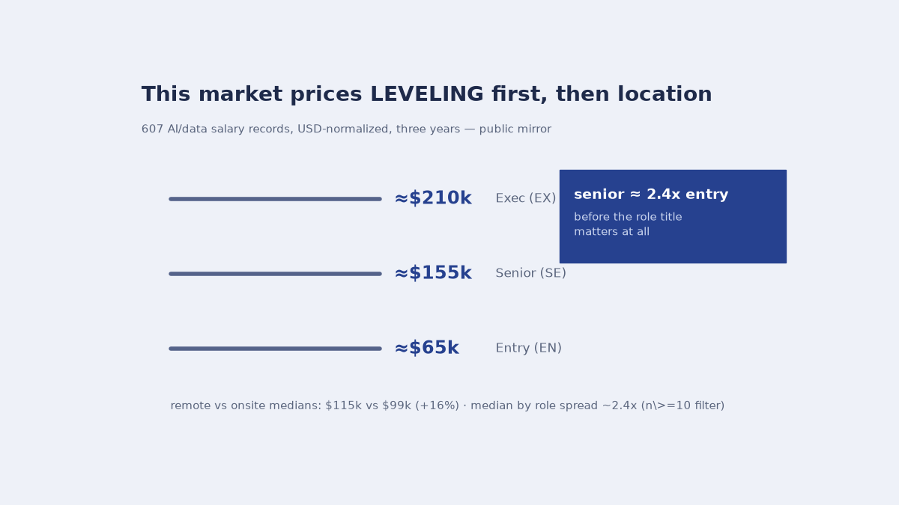
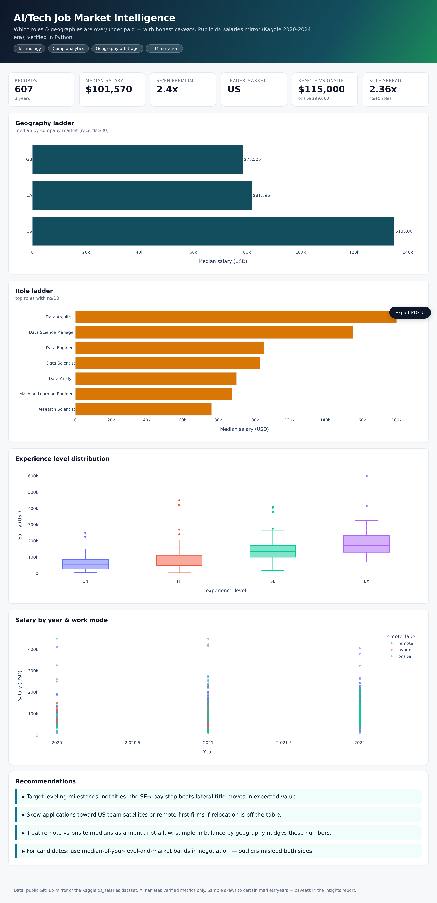

# What the AI/Data job market pays, and to whom



607 salary records, USD-normalized, three years (public mirror of the Kaggle
`ds_salaries` dataset), every claim below filtered and verified in Python:
medians by geography, role, experience level, year; box + scatter panels in
`01_analysis.py`.

## For a candidate

- **Ask about level before you ask about title.** Entry→senior runs ~**2.4×**;
  exec ≈ $210k rn. The leveling jump is the largest single factor in the data.
- **Top-role medians spread ~2.4×** too (n≥10 filter attached) — "Data
  Architect"-class specialization pays; generalist titles cluster lower.
- **Remote medians beat onsite: ~$115k vs ~$99k (+16%).** Hybrid sits between.

## For a hiring manager

- US median **$135k** with substantial distribution behind it (`seg_geo.csv`);
  other markets sit lower but the *ordering* of gaps is stable year-over-year.
- The gap ladder (`top_market` in `kpis.json`) is priced against local comps, and
  `seg_year.csv` tracks how the median has moved.

## For the analysts hired to read it

- `00_download_data.py` fetches the public mirror; `remote_ratio` is mapped to
  labels and pay unified to USD before any cut is taken.
- Sample-size filters are stated exactly: **n≥30** for geographies, **n≥10** for
  roles. Anything thinner than that isn't claimed.
- `02_ai_market_note.py` writes the career-strategy note over verified metrics
  and marks the sample caveats inline — the LLM is not allowed to invent a number.



## Run

```bash
python3 -m venv .venv && .venv/bin/pip install -r requirements.txt
.venv/bin/python src/00_download_data.py
.venv/bin/python src/01_analysis.py          # kpis.json, seg_*.csv
.venv/bin/python src/03_dashboard.py         # dashboard/index.html
.venv/bin/python src/05_banner.py            # the banner above

.venv/bin/python src/06_chat.py "remote premium"    # +16%, $115k vs $99k
.venv/bin/python src/06_chat.py "by experience"     # entry → senior → exec ladder
.venv/bin/python src/06_chat.py                     # REPL
```

`06_chat.py` recomputes answers live — US vs world, remote premium, top roles,
experience multipliers, the year trend, company-size cuts. LLM narration is
opt-in via `GROQ_API_KEY`; the offline engine returns the identical numbers.


## Honest size

~600 records skew toward some markets and recent years (the AI note says where).
Medians are not offers. Pandemic-era remote normalization makes precise
year-level claims fragile — read the three-year trend, not any one year alone.
